# Kassara (repo: HIJASI)

**Closed-loop wallet API for businesses in countries that Stripe and PayPal don't serve.**

A merchant (a farm, a game studio, a canteen) integrates our REST API. Their customers top up a
wallet through the merchant's own payment gateway, and orders are paid from that balance. We
provide the ledger, limits, refunds, idempotency and merchant vetting. The merchant keeps the money.

Each wallet can only be spent at the merchant that issued it, with no cash-out. This matches the
"closed system" prepaid instrument model in India's RBI rules, which does not need RBI
authorisation (the same model as BigBasket's wallet).

Team: Siam, Hieu, Jason — Oslo sprint hackathon 2026.

## What's in the repo

| Path | What it is |
|---|---|
| `backend/` | Python Flask API + MySQL ledger (port 5000) |
| `backend/schema.sql` | Database tables |
| `frontend/` | Landing page, merchant dashboard, admin panel, API docs (plain HTML/CSS/JS) |
| `backend/merchant_verification/` | Merchant verification module (declarations, human review, audit trail), mounted at `/verification` |
| `demo-farm/` | **Green Valley Farm**, a separate demo shop that integrates over the API (port 5001) |

Live deployment on cPanel: see [DEPLOY.md](DEPLOY.md).

## Screenshots

| | |
|---|---|
| 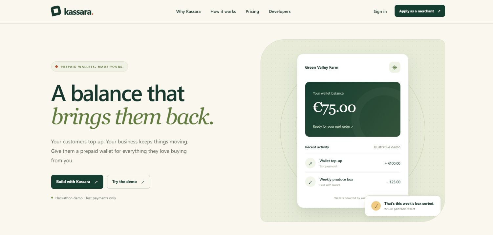 **Landing page**: what Kassara is, with an example wallet for a merchant (Green Valley Farm). | 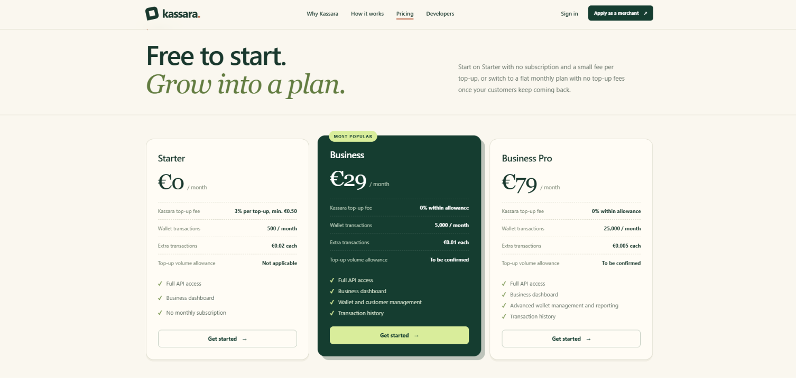 **Pricing**: Starter (free, 3% per top-up), Business €29, Business Pro €79. |
| 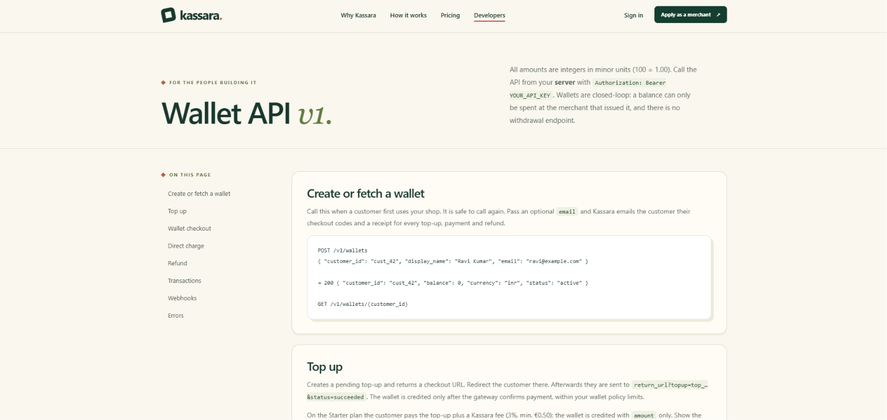 **API docs**: every endpoint with request and response examples, plus webhooks. | 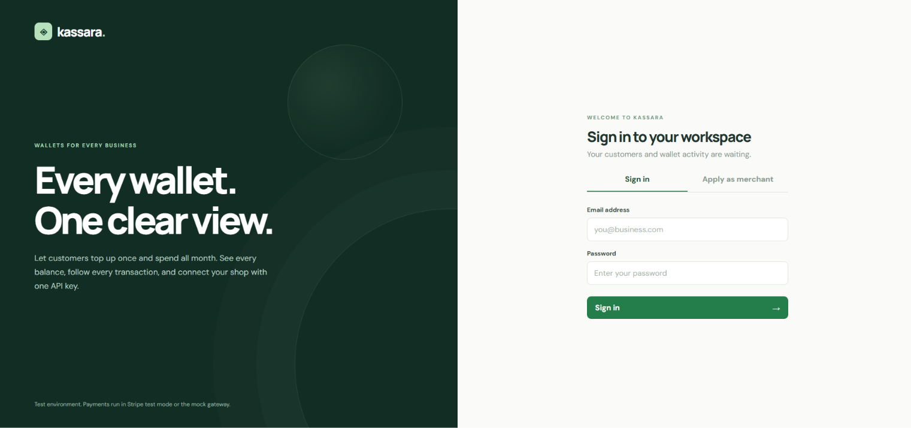 **Merchant sign in**: businesses log in to their dashboard (balances, ledger, API keys, webhooks, billing). |
| 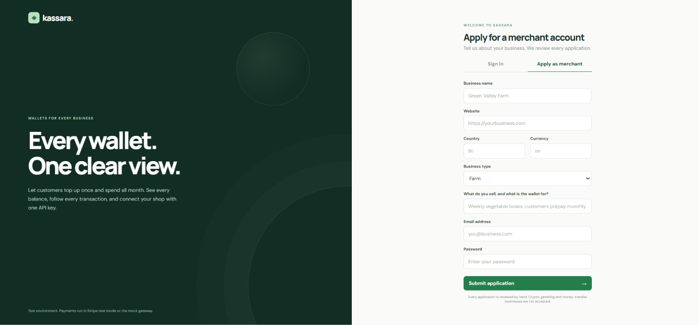 **Apply as a merchant**: businesses apply and every application is reviewed before API keys are issued. | 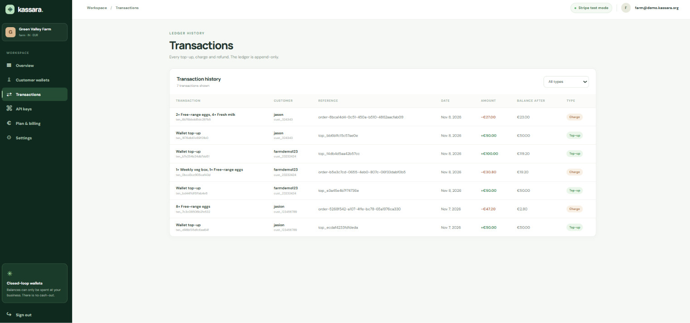 **Dashboard: transactions**: the append-only ledger of every top-up, charge and refund, with the balance after each one. |
| 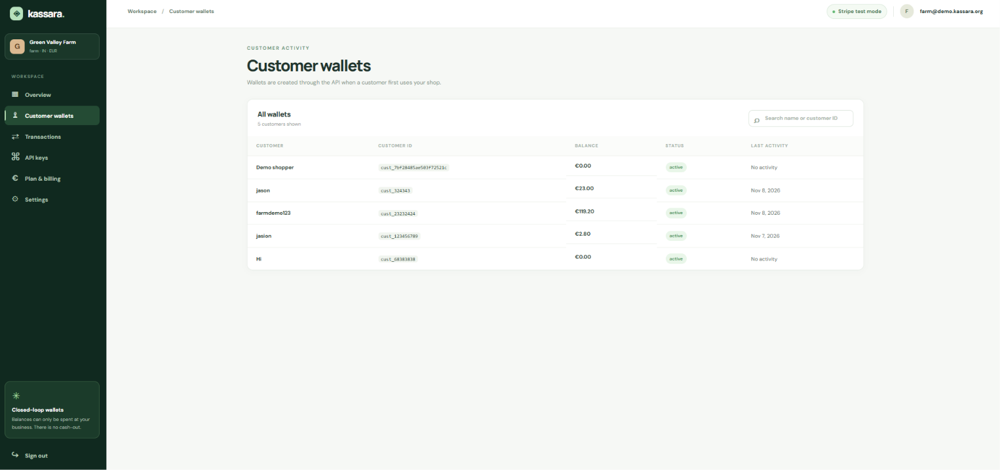 **Dashboard: customer wallets**: one wallet per customer, created through the API when they first use the shop. | 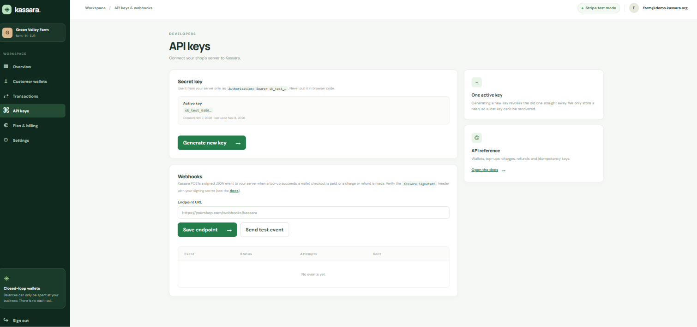 **Dashboard: API keys and webhooks**: the secret key for the shop's server, and the webhook URL Kassara sends signed payment events to. |
| 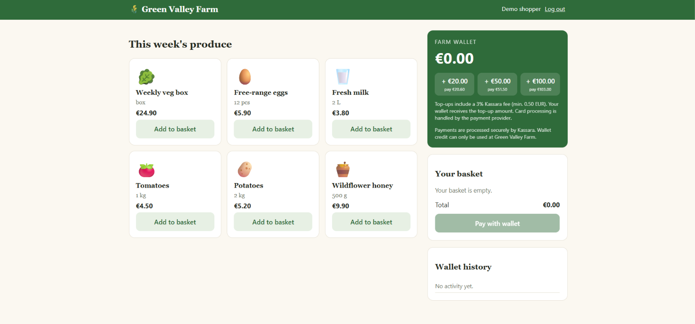 **Demo shop: Green Valley Farm**: the merchant's own storefront. The shopper signs in and sees their farm wallet. | 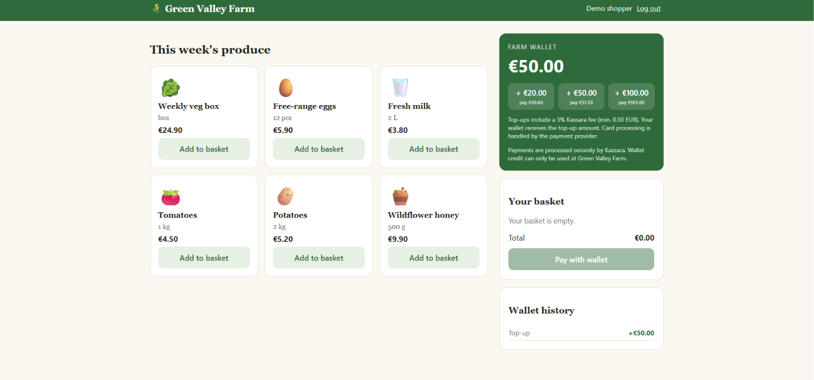 **After a top-up**: €50 paid by card (plus the Kassara fee shown on the button) lands in the wallet. |
| 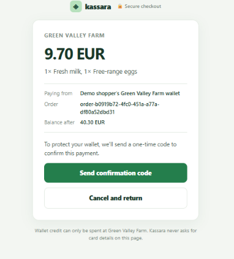 **Kassara checkout**: "Pay with wallet" sends the shopper here; they confirm with a one-time code sent to their email. | 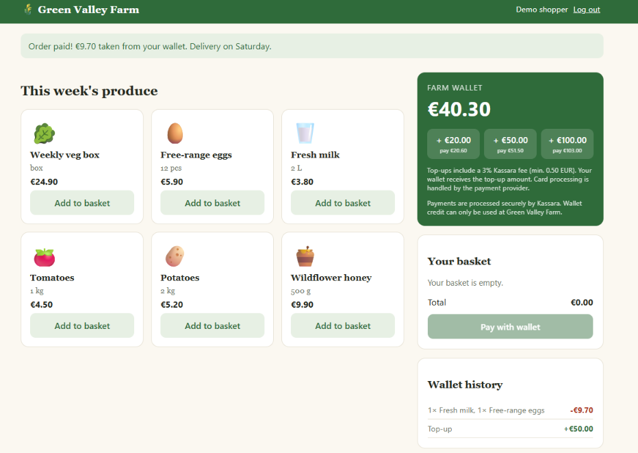 **Back in the shop**: the order is paid from the wallet and the balance and history update. |

## Live links and demo logins

| What | Where | Login |
|---|---|---|
| Landing page | https://kassara.org | — |
| Pricing | https://kassara.org/pricing | — |
| API docs | https://kassara.org/docs | — |
| Merchant dashboard | https://kassara.org/merchant | `farm@demo.kassara.org` / `farmdemo123` |
| Admin panel | https://kassara.org/admin | `ADMIN_TOKEN` from `backend/.env` |
| Demo shop (Green Valley Farm) | https://demo.kassara.org | *Use the demo shopper account*, or sign up with any email + password |

Stripe test card: `4242 4242 4242 4242`, any future date, any CVC.

## Run it

**1. MySQL + phpMyAdmin**

Use XAMPP/MAMP, a local MySQL, or Docker:

```bash
docker compose up -d        # MySQL on 3306, phpMyAdmin on http://localhost:8080 (root / rootpw)
```

**2. Backend**

```bash
cd backend
pip install -r requirements.txt
cp .env.example .env        # set DB_PASSWORD, ADMIN_TOKEN (and Stripe keys if you want)
python seed.py eur          # creates tables + approved demo merchant, writes demo-farm/.env
python app.py               # http://localhost:5000
```

**3. Demo farm**

```bash
cd demo-farm
pip install -r requirements.txt
python app.py               # http://localhost:5001
```

## Demo script

1. **Farm shop** — http://localhost:5001: click *Use the demo shopper account* (or create an account with any
   email + password), top up 50.00, add a veg box, pay with the wallet and confirm with the emailed code.
2. **Merchant dashboard** — http://localhost:5000/merchant, log in as `farm@demo.kassara.org` / `farmdemo123`:
   wallet balances, ledger, API key, top-up limits.
3. **New merchant** — apply at `/merchant#register`, then fill in the verification declaration,
   save a draft and submit it.
4. **Admin** — http://localhost:5000/admin with your `ADMIN_TOKEN`: *Start review* → tick the three
   checks, add evidence and a reason → *Approve* (or reject / request information). Suspend or
   reopen later; every step is in the audit history. Approval switches on API keys; suspend,
   reject or reopen revokes them immediately.
5. **API docs** — http://localhost:5000/docs

## Payments

- **No Stripe keys** → built-in mock gateway (a "Pay now" page). Works offline.
- **Stripe test mode** → set `STRIPE_SECRET_KEY=sk_test_…` in `backend/.env`. Pay with card
  `4242 4242 4242 4242`, any future date, any CVC. The wallet is credited when the customer comes
  back from Checkout (we verify the session with Stripe). Optionally also use the webhook:
  `stripe listen --forward-to localhost:5000/webhooks/stripe` and put the `whsec_…` into
  `STRIPE_WEBHOOK_SECRET`.

Stripe is only the demo adapter. In production a merchant plugs in the local gateway they already
use (Easebuzz, Razorpay, Paystack…) — see `backend/payments.py`.

## How money stays correct

- Money is integers in minor units, never floats.
- `ledger_entries` is append-only, with `balance_after` on every row.
- Charges lock the wallet row (`SELECT … FOR UPDATE`), so parallel orders can't overspend.
- `Idempotency-Key` on charges/refunds makes retries safe.
- Top-ups are credited exactly once, only after the gateway confirms.
- Refunds go back to the wallet and can never exceed the original charge.
- Secret API keys are stored only as SHA-256 hashes.

## How a merchant connects (the farm is the example)

All calls go from the merchant's **server** with its secret key (`Authorization: Bearer sk_test_…`).

1. **Sign-in → wallet**: `POST /v1/wallets` with the merchant's own customer id (+ email for codes and receipts).
2. **Balance / history**: `GET /v1/wallets/{customer}` and `GET /v1/wallets/{customer}/transactions`.
3. **Top-up**: `POST /v1/wallets/{customer}/topups` → returns a card checkout link. Stripe confirms to
   Kassara (`/webhooks/stripe`, event `checkout.session.completed`), the wallet is credited, the shopper returns.
4. **Pay an order**: the shop computes the total on its server → `POST /v1/checkout_sessions` → shopper
   goes to the Kassara hosted checkout, confirms with a 6-digit code sent by email → returns to the shop.
5. **Confirm**: `GET /v1/checkout_sessions/{id}` (never trust the return URL), plus signed webhooks.

### Merchant webhooks

Set a URL in the dashboard (*API keys & webhooks*). Events: `wallet.topup.succeeded`,
`wallet.charge.succeeded`, `wallet.refund.succeeded`, `checkout_session.completed`, `ping`.
Header `Kassara-Signature: t=<unix>,v1=<HMAC-SHA256 of "<t>.<body>">` using the merchant's `whsec_…`
secret. Failed deliveries retry with back-off (up to 6 attempts) and can be resent from the dashboard.
The demo shop verifies them at `/webhooks/kassara` (`KASSARA_WEBHOOK_SECRET` in `demo-farm/.env`).

## Business model

Kassara earns on top-ups; merchants keep their own product prices.

| Plan | Monthly | Top-up fee | Wallet transactions |
|---|---|---|---|
| Starter | €0 | 3%, minimum €0.50 | 500 / month, then €0.02 each |
| Business | €29 | 0% within allowance | 5,000 / month, then €0.01 each |
| Business Pro | €79 | 0% within allowance | 25,000 / month, then €0.005 each |

Fees and allowances are configurable (`backend/pricing.py`, env overrides `PLAN_<X>_…`).

## Security (pitch points)

- No card data touches Kassara: cards are handled by the payment provider (Stripe in the demo).
- Every wallet payment is confirmed with a one-time email code: 5-minute expiry, 5 attempts, stored hashed.
- Append-only ledger; row locks so balances can't go negative or be double-spent.
- Idempotency keys: retries and double-clicks never charge twice.
- Prices set by the shop's server; results verified server-side, not from the return URL.
- Signed webhooks (HMAC-SHA256 + timestamp); webhook URLs must be public https (SSRF guard).
- API keys and passwords stored hashed; keys revocable; merchants reviewed and email-verified.
- Secrets live in server-only `.env` files; code folders are blocked from web access.

## Legal position (short version — not legal advice)

Kassara is **store credit, not a bank**. Each wallet can only be spent at the business that issued
it, can't be transferred or cashed out. That closed-loop model is generally outside e-money licensing
(e.g. the EU limited-network exclusion; India's RBI "closed system" PPI). Limits apply (in the EU,
over ~€1M in 12 months the regulator must be notified), and each launch country is checked first.
For launch, top-up money should go straight to the merchant (Stripe Connect or a local gateway) so
Kassara never holds funds.

## Why this isn't "just Stripe"

Stripe (or a local gateway) only moves the money **in**, once per top-up. Kassara runs everything
after: the per-merchant wallet ledger, code-confirmed checkout with no card fee per purchase, merchant
vetting, API keys, dashboard and webhooks. Kassara pays the processor's normal fees; the processor is
swappable (`backend/payments.py`) for mobile money, bank transfer or local gateways.

## Next steps

Local payment methods (mobile money, bank transfer), more currencies, SMS codes, plugins for shop
platforms, live mode with per-merchant payouts.
